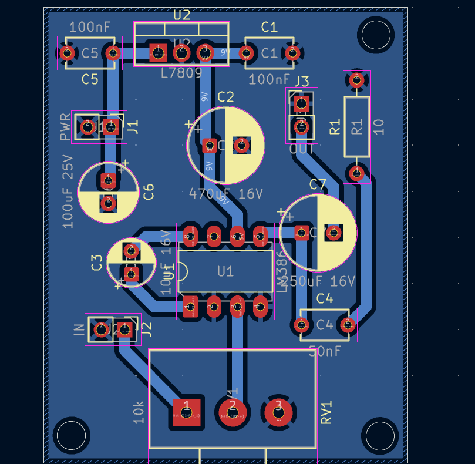
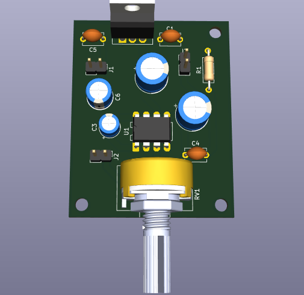

# 01 · Audio Amplifier (LM386)

A compact single-sided audio power amplifier built around the **LM386**. It takes a line-level signal (phone, MP3 player, signal generator), adds a volume control, and drives a small 8 Ω speaker. The board was hand-fabricated and tested during a university electronics course.

  
  &nbsp;
  

## Circuit overview

| Block | Parts | Function |
|-------|-------|----------|
| Power input | J1, C6 (100 µF), C5 (100 nF) | DC input with bulk and high-frequency filtering |
| Regulator | U2 L7809, C2 (470 µF), C1 (100 nF) | Regulated 9 V rail for the amplifier |
| Volume | J2 (IN), RV1 10 kΩ | Input signal goes to the top of the pot; the wiper feeds the LM386 non-inverting input |
| Amplifier | U1 LM386, C3 (10 µF across pins 1–8) | Capacitor between the gain pins raises the voltage gain from 20 to about 200 (≈46 dB) |
| Output | C7 (250 µF), J3 (OUT) | DC-blocking capacitor to the speaker |
| Stability | R1 (10 Ω) + C4 (50 nF) | Zobel network on the output to prevent high-frequency oscillation |

The input of the 7809 needs a couple of volts of headroom, so the board should be fed from roughly 12 V DC.

## PCB

| Property | Value |
|----------|-------|
| Layers | 1 (bottom copper) |
| Board size | 39.5 × 49.5 mm |
| Track width | 1.2 mm |
| Mounting | 4 × corner holes |
| Fabrication | Photoresist (UV exposure) using the PDF masks in [`fabrication/photoresist-masks/`](fabrication/photoresist-masks/) |

## Bill of materials

| Ref | Qty | Value |
|-----|-----|-------|
| U1 | 1 | LM386 (DIP-8) |
| U2 | 1 | L7809 (TO-220) |
| RV1 | 1 | 10 kΩ potentiometer |
| R1 | 1 | 10 Ω |
| C1, C5 | 2 | 100 nF |
| C2 | 1 | 470 µF 16 V |
| C3 | 1 | 10 µF 16 V |
| C4 | 1 | 50 nF |
| C6 | 1 | 100 µF 25 V |
| C7 | 1 | 250 µF 16 V |
| J1, J2, J3 | 3 | 2-pin header (PWR, IN, OUT) |

Also available as [`lm386-audio-amplifier-bom.csv`](lm386-audio-amplifier-bom.csv).

## Files

- [`kicad/`](kicad/): open `lm386-audio-amplifier.kicad_pro` in KiCad 9+
- [`fabrication/photoresist-masks/`](fabrication/photoresist-masks/): copper and silkscreen layers as PDFs

## Next step

This board became the starting point for [project 02, the TL072 audio equalizer](../02-tl072-audio-equalizer/), which adds bass and treble control in front of the amplifier stage.
