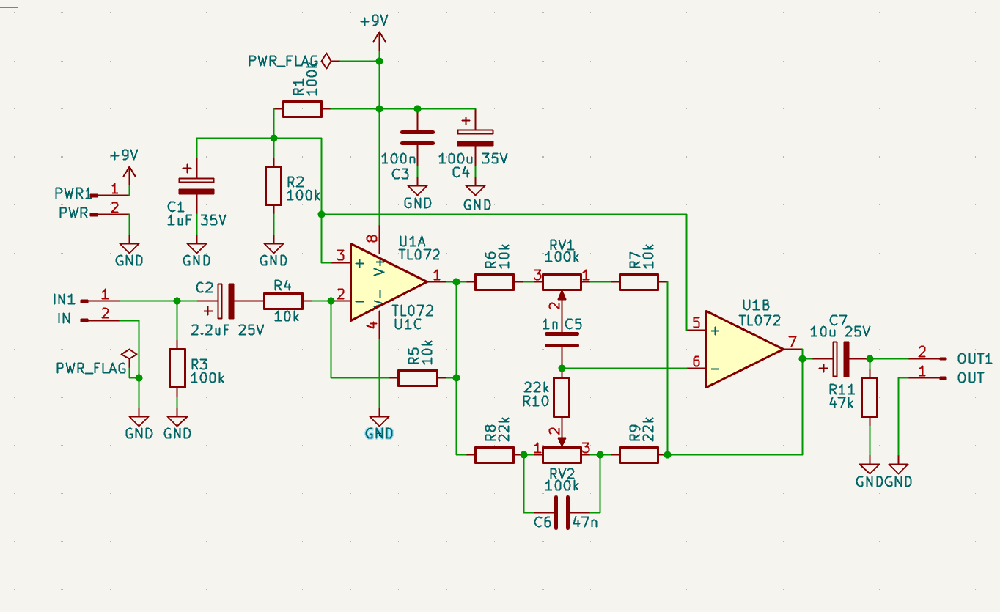
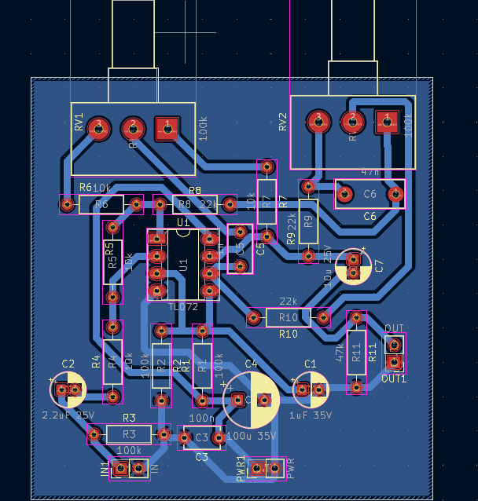
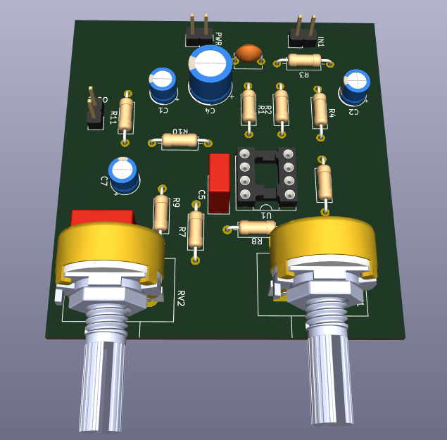

# 02 · Audio Equalizer (TL072)

An active **bass and treble tone control** built around the **TL072** dual op-amp. I designed it independently as an extension of the [LM386 amplifier](../01-lm386-audio-amplifier/): it sits in front of the power stage and lets the listener boost or cut low and high frequencies with two potentiometers.

  

  
  &nbsp;
  

## How it works

The circuit runs from a single 9 V supply, so both op-amp inputs are referenced to a mid-rail bias of about 4.5 V.

1. **Bias (R1, R2, C1).** Two 100 kΩ resistors split the 9 V rail; C1 (1 µF) filters the midpoint, which feeds the non-inverting inputs of both op-amp halves.
2. **Input buffer (U1A).** C2 (2.2 µF) blocks DC from the source and R3 (100 kΩ) references the input. U1A is an inverting stage with R4 = R5 = 10 kΩ, giving unity gain and a low-impedance drive for the tone network.
3. **Tone network (U1B).** A Baxandall-style feedback network sits between the U1A output and the U1B output, with its centre taps going to the U1B inverting input:
   - **Treble (RV1, 100 kΩ):** R6/R7 (10 kΩ) on either side of the pot; C5 (1 nF) in series with the wiper only passes high frequencies, so RV1 shifts the high-frequency gain.
   - **Bass (RV2, 100 kΩ):** R8/R9 (22 kΩ) on either side of the pot, C6 (47 nF) across the pot and R10 (22 kΩ) from the wiper. At high frequencies C6 shorts the pot out, so RV2 only acts on low frequencies.
   - With both pots centred the response is flat; turning a pot one way boosts its band, the other way cuts it.
4. **Output (C7, R11).** C7 (10 µF) removes the 4.5 V DC level and R11 (47 kΩ) references the output to ground.
5. **Supply decoupling.** C3 (100 nF) and C4 (100 µF) at the op-amp supply pin.

## PCB

| Property | Value |
|----------|-------|
| Layers | Single-sided (bottom copper) |
| Board size | 58.5 × 61.5 mm |
| Track width | 1.0 mm |
| Op-amp | DIP-8 in a socket |
| Controls | 2 × board-mounted 100 kΩ potentiometers |
| Fabrication | Photoresist masks in [`fabrication/photoresist-masks/`](fabrication/photoresist-masks/); Gerber and drill files in [`fabrication/gerbers/`](fabrication/gerbers/) |

## Bill of materials

| Ref | Qty | Value | Role |
|-----|-----|-------|------|
| U1 | 1 | TL072 | Dual op-amp (DIP-8) |
| R1, R2, R3 | 3 | 100 kΩ | Bias divider, input reference |
| R4, R5, R6, R7 | 4 | 10 kΩ | Buffer gain, treble network |
| R8, R9, R10 | 3 | 22 kΩ | Bass network |
| R11 | 1 | 47 kΩ | Output reference |
| RV1 | 1 | 100 kΩ pot | Treble |
| RV2 | 1 | 100 kΩ pot | Bass |
| C1 | 1 | 1 µF 35 V | Bias filter |
| C2 | 1 | 2.2 µF 25 V | Input coupling |
| C3 | 1 | 100 nF | Supply decoupling |
| C4 | 1 | 100 µF 35 V | Supply bulk |
| C5 | 1 | 1 nF | Treble network |
| C6 | 1 | 47 nF | Bass network |
| C7 | 1 | 10 µF 25 V | Output coupling |
| IN, OUT, PWR | 3 | 2-pin header | Connectors |

Also available as [`tl072-audio-equalizer-bom.csv`](tl072-audio-equalizer-bom.csv).

## Files

- [`kicad/`](kicad/): open `tl072-audio-equalizer.kicad_pro` in KiCad 9+
- [`fabrication/gerbers/`](fabrication/gerbers/): copper, silkscreen, board outline and drill files
- [`fabrication/photoresist-masks/`](fabrication/photoresist-masks/): copper and silkscreen PDFs for UV exposure
