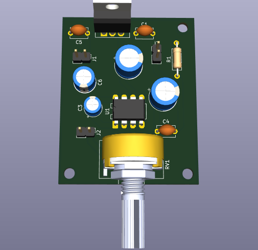
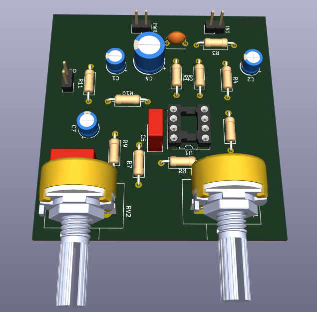

# Audio PCB Designs

Two analog audio boards designed in **KiCad 9**, from schematic to single-sided PCB to home fabrication with photoresist masks. The second project builds on the first.

| # | Project | Core IC | What it does | Status |
|---|---------|---------|--------------|--------|
| 01 | [Audio Amplifier](01-lm386-audio-amplifier/) | LM386 | Amplifies a line-level signal to drive a small speaker; on-board 9 V regulator and volume control | Hand-fabricated and tested during a university electronics course |
| 02 | [Audio Equalizer](02-tl072-audio-equalizer/) | TL072 | Active bass and treble tone control (Baxandall-style RC network) | Independent extension of project 01 |

<p align="center">
  
  &nbsp;&nbsp;
  
</p>

## Repository layout

```
audio-pcb-designs/
├── 01-lm386-audio-amplifier/
│   ├── kicad/                  KiCad 9 project (.kicad_pro, .kicad_sch, .kicad_pcb)
│   ├── fabrication/
│   │   └── photoresist-masks/  Copper and silkscreen PDFs for UV exposure
│   ├── images/                 PCB layout and 3D render
│   └── lm386-audio-amplifier-bom.csv
└── 02-tl072-audio-equalizer/
    ├── kicad/
    ├── fabrication/
    │   ├── gerbers/            Gerber + drill files
    │   └── photoresist-masks/
    ├── images/                 Schematic, PCB layout and 3D render
    └── tl072-audio-equalizer-bom.csv
```

## Opening the designs

Install [KiCad](https://www.kicad.org/) 9.0 or newer and open the `.kicad_pro` file in either `kicad/` folder. Both projects use only KiCad's standard symbol and footprint libraries.

## Skills demonstrated

- Analog circuit design: power-amplifier gain setting, output stabilisation (Zobel network), op-amp biasing on a single supply, active RC tone-control filters
- Schematic capture, footprint selection and single-layer PCB routing in KiCad
- Design for home fabrication: wide tracks, large pads, mounting holes, printable photoresist masks
- Soldering, bring-up and bench testing

## Author

**Hakim Musazada**, Electrical and Electronics Engineering
[LinkedIn](https://www.linkedin.com/in/hakim-musazada/)
